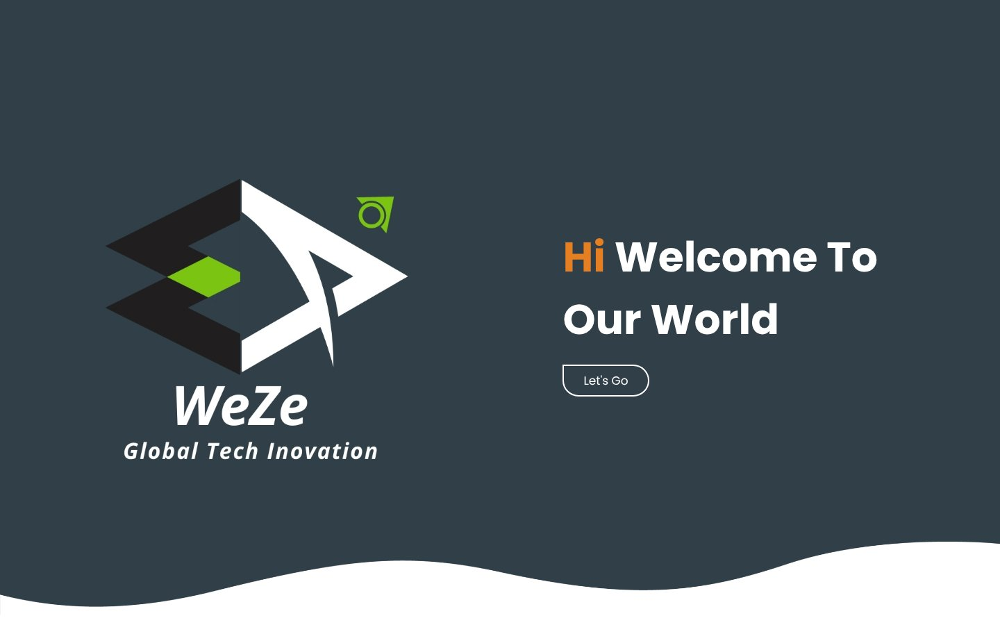
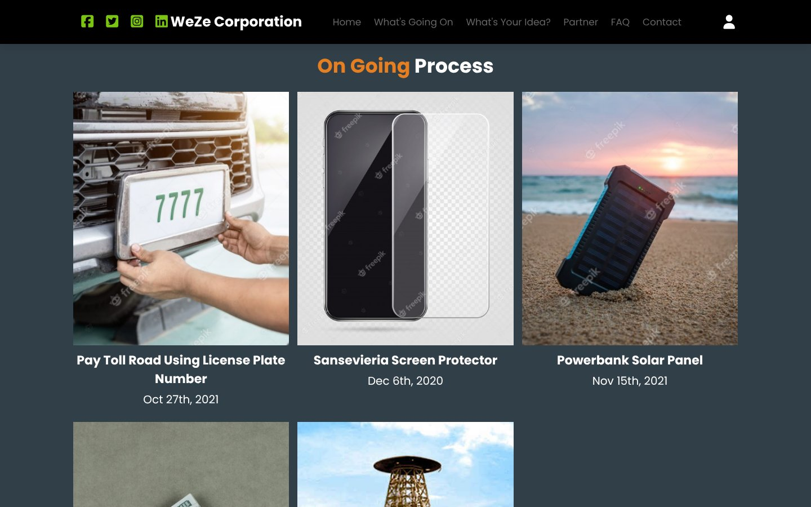
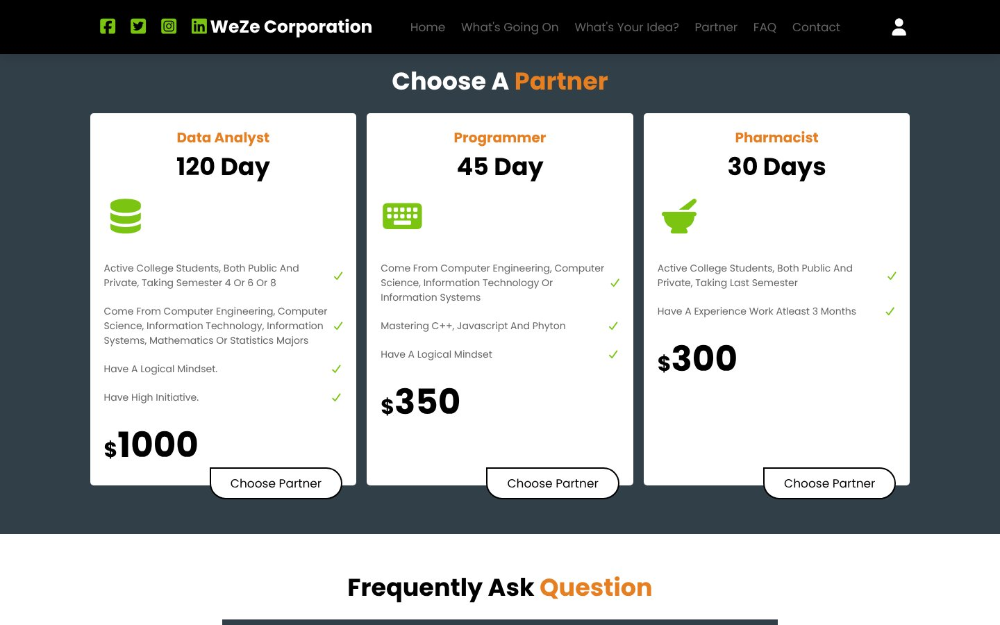
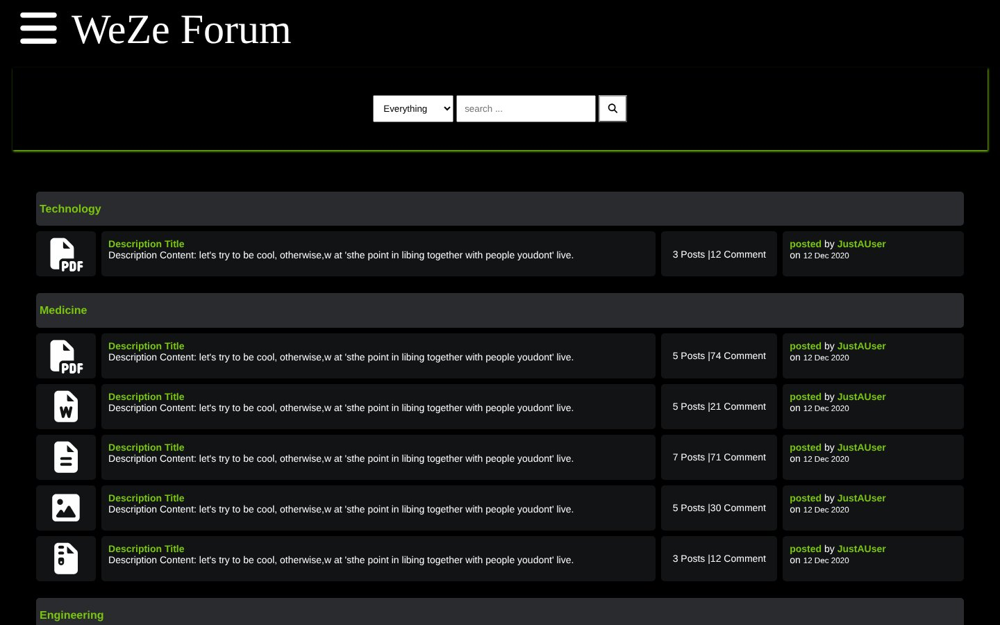
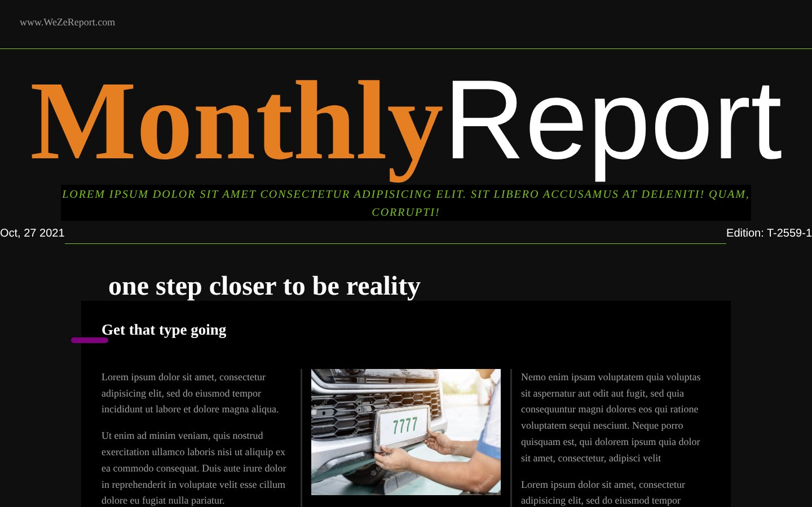
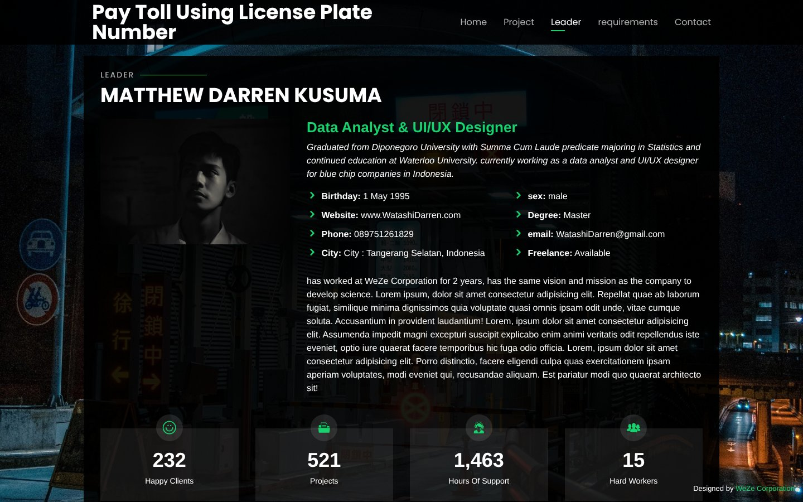

# 🌐 WeZe Corporation: Multi-Page Website

> A multi-page website for **WeZe Corporation**, a *fictional* tech-and-education startup that connects idea owners, academic experts and investors. I built it as a web programming assignment in my 3rd semester at Universitas Diponegoro (late 2021) on Sistem Informasi Manajemen course. It has a landing page, a discussion forum, a monthly report page, project-leader profile pages and a PHP/MySQL login prototype.

🔗 **Live demo:** https://gencweze.github.io/weze-corporation-website/



> ℹ️ WeZe Corporation, its projects, partners, testimonials and statistics are **fictional**, created for the assignment. Names and contact details on the partner pages are made up.

---

## 📌 Context

| | |
|---|---|
| **Type** | Course assignment, 3rd semester (Oct – Dec 2021) |
| **Brief** | Build a website for an imaginary company |
| **Stack** | HTML, CSS / SCSS, JavaScript, jQuery, Bootstrap, PHP, MySQL (XAMPP) |

## 🗺️ Pages

| Page | What it shows |
|---|---|
| `index.html` | Landing page: hero, about, *on-going projects* gallery, "share your idea" call-to-action, partner roles with pricing cards, FAQ accordion, contact form |
| `forum.html` | Discussion forum home with sub-forums (Technology, Medicine, Engineering) |
| `post.html`, `post2.html`, `post3.html` | Thread list for each sub-forum, with status icons (popular, high/low engagement, closed) and pagination |
| `detail.html` | Thread detail view with a reply box |
| `Report.html` | Newspaper-style monthly report with a responsive multi-column layout (1 → 2 → 3 columns) |
| `partner.html`, `Partner1.html` | Project-leader profile pages: bio, animated counters, skill bars, interests, testimonials carousel, requirements, contact |

## 🖼️ Screenshots

| On-going projects | Partner roles |
|---|---|
|  |  |
| **Forum** | **Monthly report** |
|  |  |
| **Project-leader profile** | |
|  | |

## ⚙️ Features

**Front end**
- Sticky header that appears on scroll, plus a mobile hamburger menu (`js/script.js`)
- Sign-in dropdown that opens from the user icon
- FAQ accordion with rotating arrow icons
- Forum navigation toggle and reply box (`js/main.js`)
- Partner pages with jQuery: section switching, count-up numbers, animated skill bars and an Owl Carousel for testimonials (`js/partner.js`)
- Responsive layouts built with Flexbox, CSS Grid, media queries and CSS multi-column; styles partly written in SCSS

**Back end (PHP + MySQL, local only)**
- `forms/login.php` checks the submitted email against the `registrasi` table
- `forms/koneksi.php` opens the database connection
- The `oprec` table stores messages from the recruitment contact form
- Database structure: [`database/schema.sql`](database/schema.sql)

## 📁 Structure

```
├── index.html, forum.html, post*.html, detail.html, Report.html, partner.html, Partner1.html
├── css/          # style sheets (+ SCSS sources)
├── js/           # script.js, main.js, partner.js
├── gambar/       # site images
├── vendor/       # Bootstrap, jQuery and plugins used by the partner pages
├── forms/        # PHP: login, DB connection, contact form
├── database/     # schema.sql (structure + fake sample rows)
└── screenshots/  # images for this README
```

## ▶️ How to Run

- **Static pages:** open `index.html` with the VS Code *Live Server* extension, or use the live demo link above.
- **Login & database:** these need a PHP server. Install XAMPP, import `database/schema.sql` in phpMyAdmin, put the folder in `htdocs`, and open `http://localhost/weze-corporation-website/`. PHP does **not** run on GitHub Pages, so the sign-in form there is display-only.

## 🔍 Known Limitations & What I'd Do Differently

This was an early learning project. Looking back at it now:

| Issue in the original code | Better approach |
|---|---|
| The sign-in form's field names don't match what `login.php` reads (`password` vs `password1`, no `login` field), so the form never reaches the check | Keep form names and server variables consistent, and test the full flow end to end |
| The password check uses `var_dump()` on an undefined variable, so any password would pass | Hash passwords with `password_hash()` and check them with `password_verify()` |
| User input goes straight into the SQL query | Use prepared statements (`mysqli_prepare`) to prevent SQL injection |
| Passwords were stored in plain text | Never store raw passwords; the schema now notes this |
| Much of the content is placeholder text (lorem ipsum) | Write real copy, even for a fictional brand |

The code is kept as it was written in 2021, so the project shows my starting point honestly.

## 🧹 Portfolio Note

The original SQL exports contained real emails and plain-text passwords, so they are not included. [`database/schema.sql`](database/schema.sql) recreates the same tables with fake sample data.

## 🧱 Credits

- Partner pages and `vendor/php-email-form` are based on a free **BootstrapMade** template [[CEK: nama template, mis. "Personal"]], customized with WeZe content and colors.
- The landing-page layout follows a web-design tutorial, restyled into the WeZe brand.
- Project images are **Freepik** previews (watermarked), used for a non-commercial student assignment.
- Partner profile photos are of friends, used with their permission.
- Icons: Font Awesome, Boxicons, IcoFont, Remix Icon. Fonts: Google Fonts.

## 💡 What I Learned

- Structuring a **multi-page site** with shared styles and consistent navigation
- **Responsive layout** with Flexbox, CSS Grid, media queries and CSS multi-column
- Adding interaction with **vanilla JavaScript and jQuery**
- The basics of a **PHP + MySQL** login flow, and why hashing and prepared statements matter

---

↩️ Back to [my profile](https://github.com/gencWeze)
